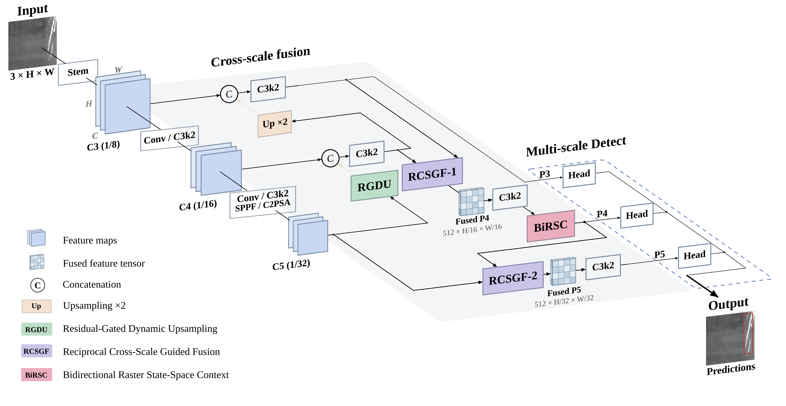
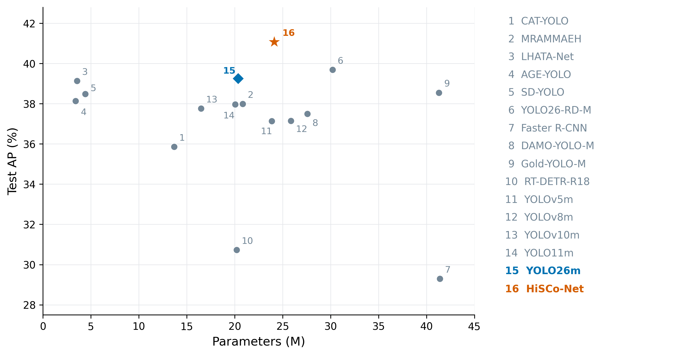
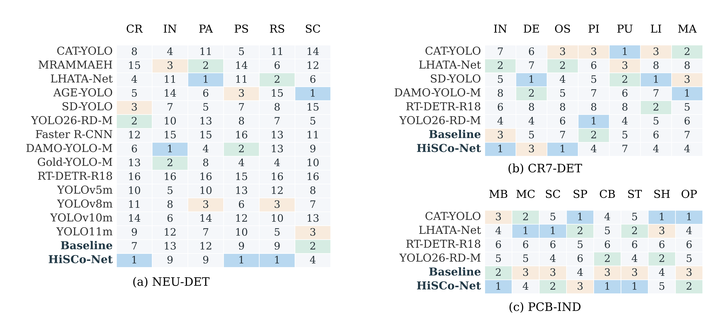
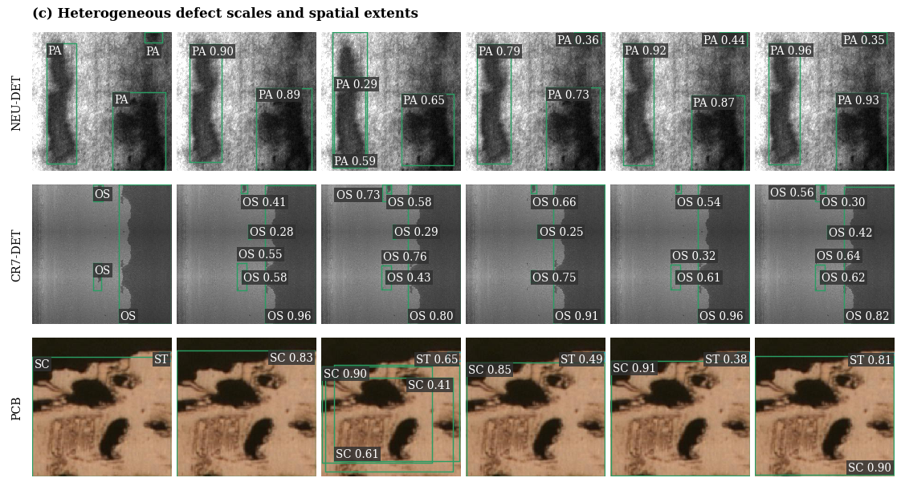
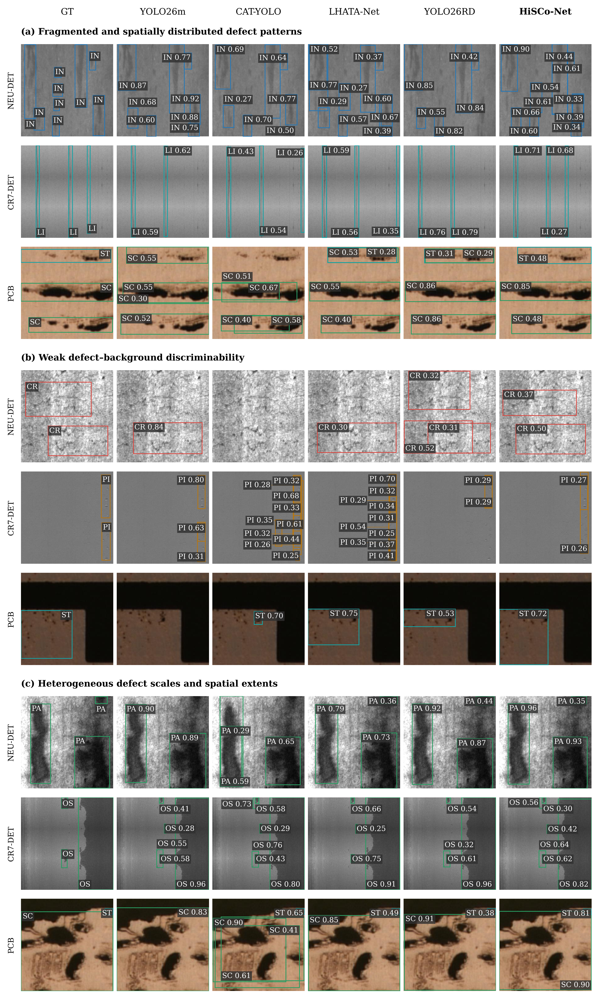

# HiSCo-Net

**Hierarchical Scale-Context Coordination Network** for industrial surface-defect detection.

HiSCo-Net is a YOLO26m-based detector for industrial surface defects. It coordinates spatial reconstruction, cross-scale interaction, and contextual propagation within a unified feature hierarchy. An intermediate-scale representation connects local defect evidence with semantic context before multi-scale prediction.

[Architecture](#2-overall-architecture) · [Results](#3-benchmark-results) · [Datasets](#5-datasets) · [Availability](#6-release-status-and-installation) · [Evaluation](#8-coco-evaluation)

## 1. Overview and highlights

Fragmented defects, weak texture contrast, and large variations in spatial extent make reliable defect representation difficult. HiSCo-Net addresses these challenges through **hierarchical scale–context coordination**, with P4 serving as a shared information junction for detection and subsequent cross-scale fusion.

* **RCSGF — Reciprocal Cross-Scale Guided Fusion:** neighboring feature scales guide each other to exchange local detail and higher-level evidence.
* **RGDU — Residual-Gated Dynamic Upsampling:** a nearest-interpolation reference anchors learned spatial corrections at the P5→P4 transition.
* **BiRSC — Bidirectional Raster State-Space Context:** bidirectional context enriches P4 and supplies both its detection path and the following P5 fusion stage.

The architectural contribution is the connected information path formed by these mechanisms. HiSCo-Net retains YOLO26's native end-to-end, NMS-free prediction interface.

## 2. Overall architecture



RGDU reconstructs the semantic-to-spatial transition, RCSGF coordinates adjacent scales, and BiRSC contextualizes the intermediate representation. The enriched P4 supports direct prediction and further P5 fusion, connecting context modeling with hierarchical feature redistribution.

## 3. Benchmark results

Paper-reported HiSCo-Net test results from COCOeval. All values are percentages. Each dataset has a separate training and evaluation experiment.

| Dataset | AP | AP50 | AP75 | AR100 |
|---|---:|---:|---:|---:|
| NEU-DET | **41.07** | **72.84** | **42.40** | 65.50 |
| CR7-DET | **53.40** | **82.37** | **54.99** | 70.44 |
| PCB-IND | **63.19** | **83.07** | **72.17** | 81.95 |

On NEU-DET, HiSCo-Net improves AP and AP50 by **1.82** and **3.70 percentage points** over the YOLO26m baseline reported in the current comparison table. Class-wise results show complementary strengths rather than uniform gains across all defect categories.



The scatter includes every method in the NEU-DET comparison table. It shows the accuracy–size trade-off without assuming that added parameters alone explain the result.



Within-dataset AP50 ranks by defect category (1 = best). Each panel's n is the number of compared methods. [Vector PDF](assets/per_class_ap50_rank.pdf).


## 4. Visual results



Rows: NEU-DET, CR7-DET, PCB-IND. Columns: GT, YOLO26m, CAT-YOLO, LHATA-Net, YOLO26-RD, HiSCo-Net. Box-label numbers are prediction confidence scores.

<details>
<summary>View the complete challenge-driven qualitative comparison</summary>



The examples cover fragmented patterns, weak defect–background contrast, and heterogeneous spatial extents. They illustrate detection behavior and complement the aggregate benchmark results.

</details>

## 5. Datasets

We evaluate HiSCo-Net on NEU-DET, CR7-DET, and PCB-IND. Download the original datasets from their providers:

| Dataset | Download | Configuration |
|---|---|---|
| NEU-DET | [Official page](https://faculty.neu.edu.cn/songkc/en/zdylm/263265/list/) | [neu.yaml](data/neu.yaml) |
| CR7-DET | [Project repository](https://github.com/jsq0903/CR7-DET) | [cr7.yaml](data/cr7.yaml) |
| PCB-IND | [Project repository](https://github.com/gnmtdt/PCB-IND) / [Zenodo](https://doi.org/10.5281/zenodo.19723114) | [pcb.yaml](data/pcb.yaml) |

All three datasets use approximately **70%/15%/15%** train/val/test splits. The exact image membership is public in [data/splits](data/splits/), with class mappings in the dataset YAMLs above. PCB-IND uses the updated **3352/718/719-image** partition, not the earlier 80%/10%/10% partition. Original images remain available from the dataset providers.

The public NEU-DET partition contains **1800 image files**: **1262 training**, **272 validation**, and **266 test** images. Exact membership and file checksums are provided in the [NEU split manifest](data/splits/neu/split_manifest.json).

## 6. Release status and installation

This is a pre-publication research release containing the project overview, benchmark figures, dataset definitions, exact split membership, model YAMLs, three dataset-specific checkpoints, and a standalone COCO JSON evaluator. The YAMLs expose module placement and network connectivity; detailed module implementations and executable model inference/training code are not included at this stage. Their release is planned after paper acceptance.

Install the public evaluator dependencies:

```powershell
cd HiSCo-Net
python -m pip install -r requirements.txt
```

The JSON evaluator runs on CPU and does not require PyTorch, CUDA, or Mamba. It evaluates existing detections; it does not run HiSCo-Net inference.

The published `.pt` files are full-object PyTorch checkpoints, not standalone inference executables. Loading them requires the matching module definitions and runtime, which are not part of this source-limited release. Installing the JSON evaluator dependencies alone does not enable checkpoint inference. Full-object files can reveal model hierarchy and parameter shapes; their publication does not conceal the entire architecture.

## 7. Training protocol

Models are trained from scratch with 640×640 input and batch size 4. The NEU-DET reference recipe uses 300 epochs, SGD, `lr0=0.01`, `lrf=0.01`, a linear schedule, `weight_decay=0.0005`, `close_mosaic=30`, and seed 20260725. The updated PCB-IND experiment uses 200 epochs, `weight_decay=0.001`, and `close_mosaic=20`, with the same optimizer, learning-rate schedule, input size, batch size, and seed. Executable training instructions will accompany the model-code release.

## 8. COCO evaluation

Compute COCO metrics from an existing ground-truth JSON and prediction-list JSON:

```powershell
python evaluate.py --gt ground_truth.json --pred predictions.json --split test --output runs/test_coco_eval_summary.json
```

The evaluator runs **pycocotools.COCOeval**, not native YOLO metric aggregation, and reports AP, AP50, AP75, APs/APm/APl, AR100, per-class AP, and per-class AP50. It uses COCO `maxDets=[1,10,100]` and IoU thresholds 0.50:0.05:0.95. Values in the output JSON are fractions, not percentages; absent categories are reported as `null` for per-class metrics. Use `--split val` to label a validation evaluation; this flag does not select images, so the input JSONs must already represent the intended partition.

GT and predictions must share the same image/category IDs and use original-image pixel coordinates with `[x, y, width, height]` boxes. Supply complete predictions without a visualization confidence cutoff. The paper's model inference uses GPU FP32, batch 1, square 640×640 letterboxing, and native O2O top-k without NMS; these are prediction-generation settings, not operations performed by this standalone evaluator.

## 9. Availability, citation and license

Dataset configurations, partition membership, model YAMLs, and the following checkpoints are available now. The [modules](modules/README.md) directory records model-code availability without disclosing implementations. Module source code and the executable model runtime remain withheld until the planned post-acceptance release. Raw datasets and experiment logs are not bundled.

| Dataset | Classes | Model YAML | Checkpoint |
|---|---:|---|---|
| NEU-DET | 6 | [HiSCoNet_neu.yaml](models/HiSCoNet_neu.yaml) | [HiSCoNet_pretrained_neu.pt](weights/HiSCoNet_pretrained_neu.pt) |
| CR7-DET | 7 | [HiSCoNet_cr7.yaml](models/HiSCoNet_cr7.yaml) | [HiSCoNet_pretrained_cr7.pt](weights/HiSCoNet_pretrained_cr7.pt) |
| PCB-IND | 8 | [HiSCoNet_pcb.yaml](models/HiSCoNet_pcb.yaml) | [HiSCoNet_pretrained_pcb.pt](weights/HiSCoNet_pretrained_pcb.pt) |

Please cite the HiSCo-Net paper when available. Software references: [Ultralytics](https://github.com/ultralytics/ultralytics), [DySample](https://github.com/tiny-smart/dysample), [Mamba](https://github.com/state-spaces/mamba), and the [COCO API](https://github.com/cocodataset/cocoapi). Applicable upstream licenses and attribution requirements remain in effect.
